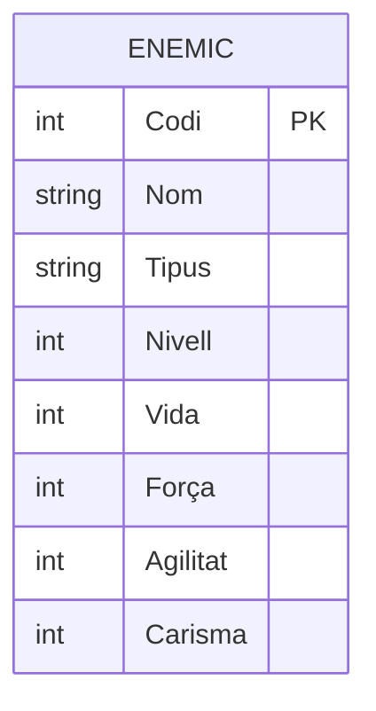
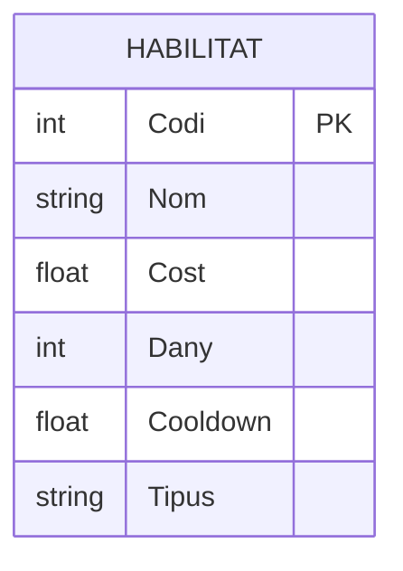

# Guia per a la Creació de Diagrames Entitat/Relació (E/R) en format Mermaid
## Objetivo
Este documento explica, paso a paso, cómo se construye un diagrama Entidad/Relación en formato Markdown + Mermaid a partir del diseño conceptual del videojuego que aparece en el PDF adjunto (Model conceptual). Primero se identifican las entidades y sus atributos; después se representan las relaciones con sus cardinalidades y, finalmente, se presenta el diagrama completo.

Para construir el diagrama se ha seguido la guía de creación de diagramas E/R en Mermaid del aula.

## 1. Entidades y atributos
Del modelo conceptual se extraen cinco entidades:
| Entidad    | Descripción                                                                        |
| ---------- | ---------------------------------------------------------------------------------- |
| Enemic     | Enemigos que se enfrentan a los personajes y a las habilidades.                    |
| Personatge | Personajes que poseen habilidades, equipan ítems y están acompañados por mascotas. |
| Habilitat  | Habilidades que pueden poseer los personajes y combinarse entre sí.                |
| Mascota    | Mascotas que acompañan a los personajes y cargan ítems.                            |
| Item       | Objetos del videojuego.                                                            |

## Convenciones aplicadas
Siguiendo la guía:

Los nombres de las entidades se escriben en MAYÚSCULAS.

Los atributos se definen dentro de las llaves {} de su entidad, con el tipo de dato y el nombre. El PDF no especifica tipos de datos, así que son una propuesta razonable.

Los atributos subrayados en el PDF son los identificadores: se marcan con la restricción PK (Primary Key).

Los atributos compuestos se desglosan directamente en sus componentes como atributos simples, porque Mermaid no tiene una sintaxis específica para ellos. Es el caso de Mesures, que se divide en X, Y y Z.

En el PDF, Comerciable aparece dos veces dentro de Item; se considera un duplicado y se representa una sola vez.

No se añaden claves foráneas ni tablas intermedias: se quiere representar el modelo conceptual, no su transformación al modelo relacional.

Enemic
El identificador es Codi. El resto de atributos describen al enemigo y sus estadísticas.

    Personatge
El identificador es el DNI. Se propone string porque es un identificador, no una cantidad.

Habilitat
El identificador es Codi. Cost y Cooldown se proponen como float porque pueden tener decimales.

