# Guia per a la Creació de Diagrames Entitat/Relació (E/R) en format Mermaid
## Objetivo
Este documento explica, paso a paso, cómo se construye un diagrama Entidad/Relación en formato Markdown + Mermaid a partir del diseño conceptual del videojuego que aparece en el PDF adjunto (Model conceptual). Primero se identifican las entidades y sus atributos; después se representan las relaciones con sus cardinalidades y, finalmente, se presenta el diagrama completo.

Para construir el diagrama se ha seguido la guía de creación de diagramas E/R en Mermaid del aula.

## 1. Entidades y atributos
Del modelo conceptual se extraen cinco entidades:
| Entidad    | Descripción                                                                        |
| ---------- | ---------------------------------------------------------------------------------- |
| Enemic     | Enemigos que se enfrentan a los personajes y a las habilidades.                    |
| Personatge | Personajes que poseen habilidades, equipan ítems y están acompañados por mascotas. |
| Habilitat  | Habilidades que pueden poseer los personajes y combinarse entre sí.                |
| Mascota    | Mascotas que acompañan a los personajes y cargan ítems.                            |
| Item       | Objetos del videojuego.                                                            |

## Convenciones aplicadas
Siguiendo la guía:

Los nombres de las entidades se escriben en ***MAYÚSCULAS***.

Los atributos se definen dentro de las llaves {} de su entidad, con el tipo de dato y el nombre. El PDF no especifica tipos de datos, así que son una propuesta razonable.

Los atributos subrayados en el PDF son los identificadores: se marcan con la restricción PK (Primary Key).

Los atributos compuestos se desglosan directamente en sus componentes como atributos simples, porque Mermaid no tiene una sintaxis específica para ellos. Es el caso de Mesures, que se divide en X, Y y Z.

En el PDF, Comerciable aparece dos veces dentro de Item; se considera un duplicado y se representa una sola vez.

No se añaden claves foráneas ni tablas intermedias: se quiere representar el modelo conceptual, no su transformación al modelo relacional.

***Enemic***
El identificador es Codi. El resto de atributos describen al enemigo y sus estadísticas.

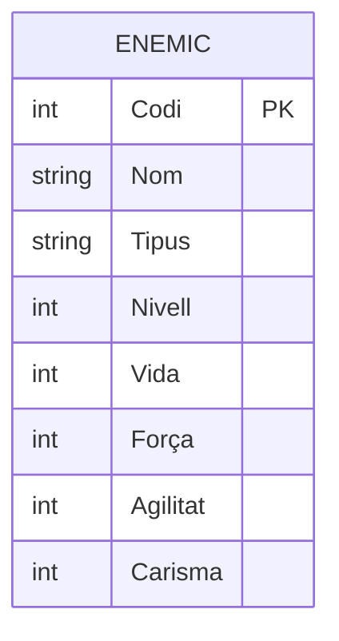

   ***Personatge***
El identificador es el DNI. Se propone string porque es un identificador, no una cantidad.

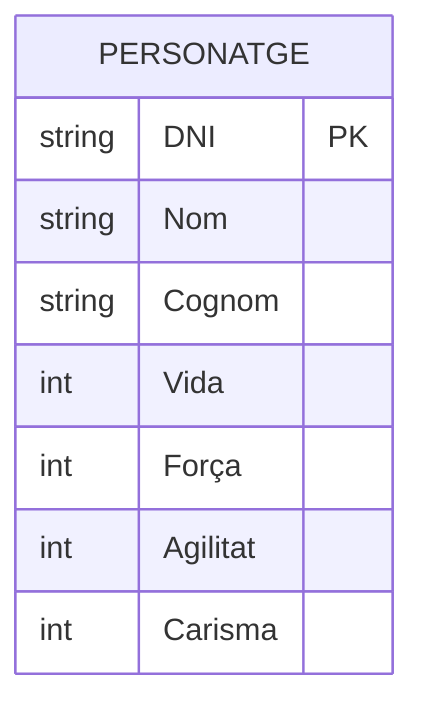
***Habilitata***
El identificador es Codi. Cost y Cooldown se proponen como float porque pueden tener decimales.

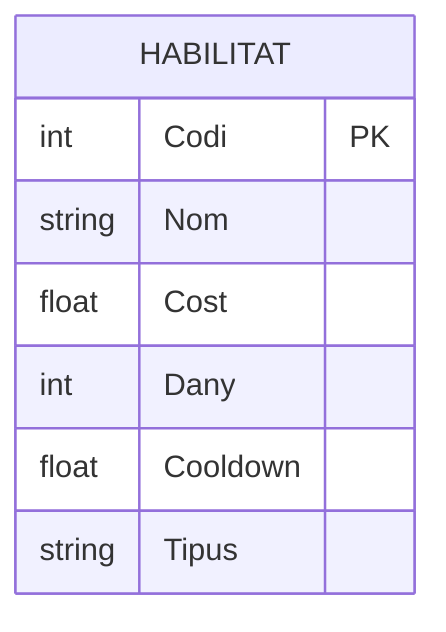
***Mascota***
El identificador es Num.Chip; se normaliza como Num_Chip para mantener una nomenclatura uniforme. Motxilla se propone como string, ya que el PDF no concreta qué representa (¿un nombre, una capacidad...?).
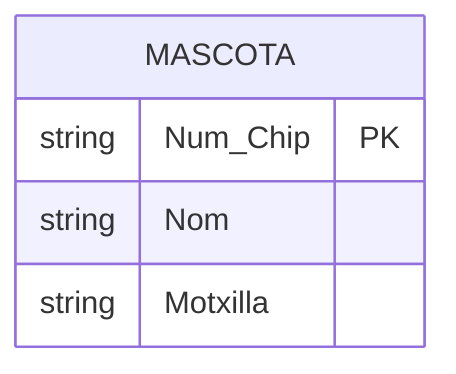

***Item***
El identificador es Codi. Equipable y Comerciable se proponen como boolean porque responden a sí/no. El atributo compuesto Mesures se desglosa en sus tres componentes (X, Y, Z), tal como indica la guía para los atributos compuestos.
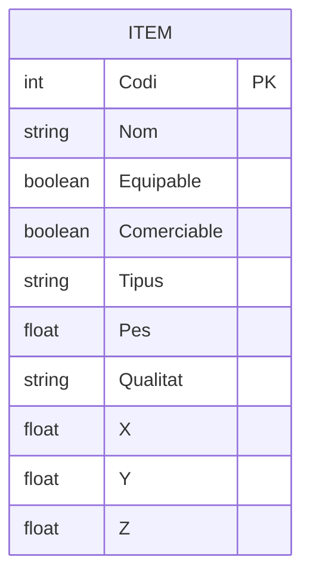

## 2. Relaciones y cardinalidades
El modelo conceptual incluye siete relaciones. En Mermaid, cada extremo de la línea usa un símbolo que indica la cardinalidad (mínimo y máximo):

| Símbolo | Significado     |
| ------- | --------------- |
| \\\|o   | Cero o uno      |
| \\\|\\\| | Exactamente uno |
| }o      | Cero o muchos   |
| }\\\|   | Uno o muchos    |

El PDF solo indica las cardinalidades máximas (1, N, M) con un solo símbolo por extremo, no la participación mínima. En esta propuesta se asume como convención que el mínimo es cero (participación parcial), salvo en la relación 1:1, donde se opta por obligatoriedad en ambos extremos. Si el enunciado o el profesor indican otra participación mínima, basta con cambiar el símbolo del extremo correspondiente.

### 2.1 Enfrenta (Enemic – Personatge)
Un enemigo puede enfrentarse a varios personajes, y un personaje puede enfrentarse a varios enemigos: relación N:M.

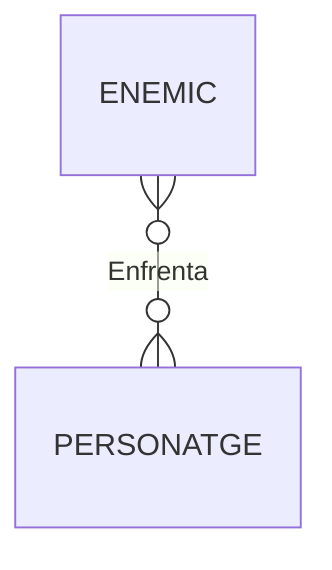
### 2.2 Enfrenta (Enemic – Habilitat)
El modelo usa el mismo nombre Enfrenta para otra relación, esta vez entre enemigos y habilidades: también N:M. Se conserva el nombre tal como aparece en el PDF.

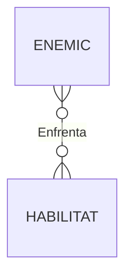

### 2.3 Poseeix (Personatge – Habilitat)
Un personaje puede poseer varias habilidades, y una misma habilidad puede estar asociada a varios personajes: relación M:N.
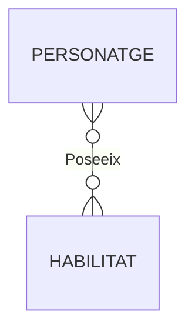

### 2.4 Combina amb (Habilitat – Habilitat)
Es una relación reflexiva (o recursiva): la entidad HABILITAT se relaciona consigo misma. Una habilidad puede combinarse con varias habilidades, y puede aparecer en varias combinaciones: relación M:N.

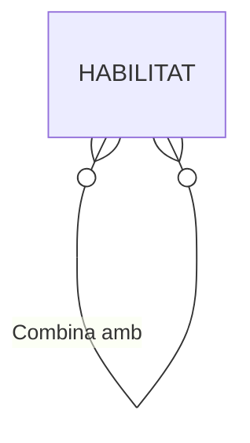

### 2.5 Acompanya (Mascota – Personatge)
Relación 1:1: cada mascota acompaña exactamente a un personaje y cada personaje está acompañado por exactamente una mascota. Se escribe MASCOTA primero para que la etiqueta se lea de forma natural ("una mascota acompaña a un personaje").

En esta propuesta se usa || en los dos extremos, lo que supone obligatoriedad en ambos sentidos; el PDF indica el máximo 1 pero no el mínimo.

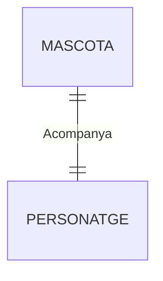

### 2.6 Equipa (Personatge – Item)
Un personaje puede equipar varios ítems, y un ítem puede estar equipado por varios personajes: relación M:N.

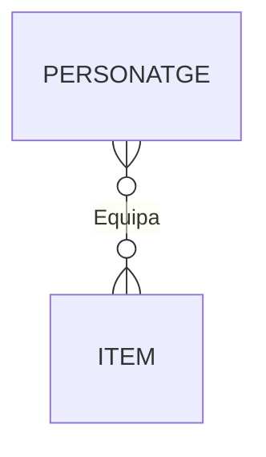

### 2.7 Carrega (Mascota – Item)
El PDF dibuja esta relación pero no indica su cardinalidad. Para poder representarla se propone como hipótesis una relación 1:N: una mascota puede cargar cero o varios ítems, y cada ítem puede estar cargado por una mascota como máximo (símbolo |o: cero o uno). Esta decisión debe confirmarse con el profesor.

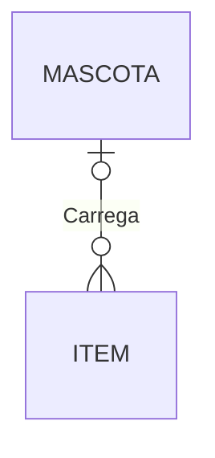

## 3. Resumen de decisiones e hipótesis

| Decisión                                     | Justificación                                                   |
| -------------------------------------------- | --------------------------------------------------------------- |
| Tipos de datos (int, string, float, boolean) | El PDF no los especifica; son una propuesta.                    |
| Num_Chip en lugar de Num.Chip                | Normalización para mantener una nomenclatura uniforme.          |
| Mesures desglosado en X, Y, Z                | Convención de la guía para atributos compuestos.                |
| Comerciable representado una sola vez        | Aparece duplicado en el PDF; parece un error del dibujo.        |
| Mínimo 0 en las relaciones N:M y M:N         | El PDF solo indica los máximos; se asume participación parcial. |
| \\\|\\\| en los dos extremos de Acompanya    | Se asume obligatoriedad en la relación 1:1.                     |
| Carrega como 1:N (\\\|o--o{)                 | El PDF no indica cardinalidad; hipótesis a confirmar.           |
| Sin claves foráneas ni tablas intermedias    | Es un modelo conceptual, no el modelo relacional.               |
